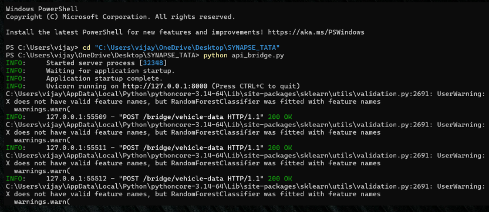
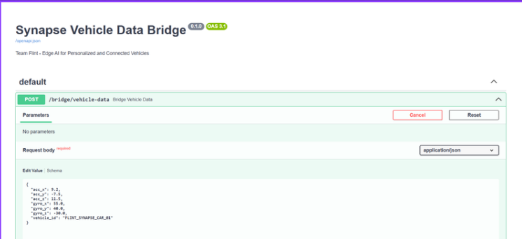
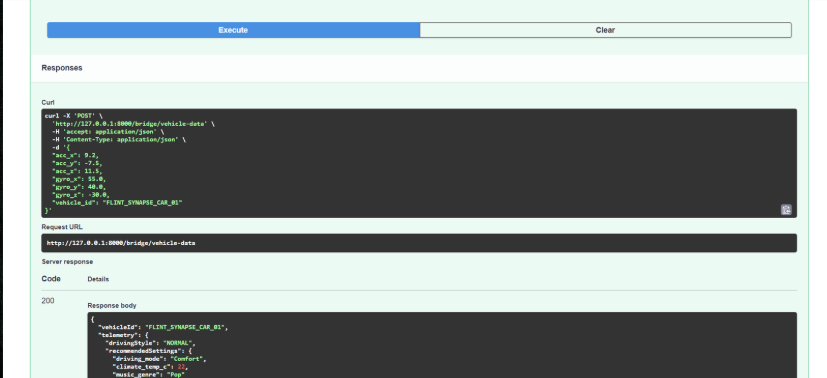

# Synapse: Edge AI for Personalized and Connected Vehicles

**Tata Technologies InnoVent Hackathon** | **Team Flint** (solo entry) | Python · OpenCV · scikit-learn · ONNX Runtime · FastAPI

Synapse is a working prototype built **solo** by me, Vignathi Bhairavabhotla, for the **Tata Technologies InnoVent hackathon**, competing under the team name **Flint**. It is a car that recognises its driver, adapts to their driving style, and talks to the cloud in a common data format, with the intelligence running **on the device**, not in the cloud.

▶ **[Watch the demo video](https://drive.google.com/file/d/1pSmbda7Yeki5iDJHgqjeoaBgWAmOgLD6/view?usp=sharing)**: I recorded a full end-to-end demo showing driver recognition switching between personalised profiles, real-time driving-style prediction, the API bridge translating sensor data into a cloud format live, and V2X-based recommendation changes.

📄 **Slides:** [`docs/Flint_presentation.pdf`](docs/Flint_presentation.pdf)

## The problem

- Cabin personalisation (seat, climate, music, drive mode) usually stops working without a network connection, and driver data ends up outside the driver's control.
- Onboard sensors, insurer portals, fleet systems and carmaker clouds use incompatible data formats, which blocks predictive maintenance and usage-based insurance.
- Personalisation and connectivity are treated as separate problems, but a connected car needs both at once.

## What Synapse does

1. **On-device driver recognition.** OpenCV face detection (Haar cascade) and LBPH recognition identify the driver locally. No cloud call is made. The recognised driver's profile (seat, temperature, music, drive mode) is loaded from `profiles.json`.
2. **Real-time driving-style prediction.** A Random Forest classifier labels driving style from live accelerometer and gyroscope readings. Four algorithms were compared on identical data and the best was selected.
3. **Edge-ready deployment.** The chosen model is exported to **ONNX** and run with ONNX Runtime, with a measured inference latency of **2.84 ms**, suitable for embedded targets such as Raspberry Pi or Jetson Nano.
4. **Interoperability bridge.** A FastAPI service converts raw sensor payloads into a standardised cloud telematics format.
5. **Connected context (simulated V2X).** A mock feed (`mock_v2x_feed.json`) supplies weather and traffic context that can override a recommendation, for example rain overriding Sport mode.

## Results

Four models were trained and compared on the same driving-behaviour data (accelerometer and gyroscope readings). Raw readings alone gave about 44% accuracy. **Feature engineering** (motion magnitude and rolling-window statistics) raised accuracy to **90.3%**.

| Model | Accuracy | F1 (macro) | Training time |
|---|---|---|---|
| **Random Forest (selected)** | **90.3%** | **0.902** | 1.72 s |
| Gradient Boosting | 78.5% | 0.784 | 4.28 s |
| SVM (RBF kernel) | 55.3% | 0.526 | 0.18 s |
| Logistic Regression | 54.2% | 0.530 | 0.06 s |

Random Forest captured the non-linear patterns in motion-sensor data far better than the linear models, and trained faster than Gradient Boosting. The ONNX export of the selected model runs in **2.84 ms** per inference. Full numbers are in [`model_comparison_results.csv`](model_comparison_results.csv).

## Architecture

```
Webcam -> Face detection (Haar) -> LBPH recognition -> Driver profile lookup ----+
                                                                                  +--> Cabin settings / dashboard
Accelerometer + gyroscope -> Driving-style model (Random Forest / ONNX) ---------+
Mock V2X feed (weather, traffic) -----------------------------------------------+
Raw sensor payload -> FastAPI bridge -> standard cloud telematics JSON
```

## Repository structure

| File | Purpose |
|---|---|
| `capture_faces.py` | Captures face images for a driver (stored locally in `dataset/`) |
| `train_model.py` | Trains the LBPH face-recognition model |
| `train_style_model.py` | Trains the Random Forest driving-style model on `train_motion_data.csv` |
| `compare_models.py` | Compares four classifiers, writes `model_comparison_results.csv` |
| `convert_to_onnx.py` | Exports the model to ONNX and measures inference latency |
| `api_bridge.py` | FastAPI interoperability bridge (`POST /bridge/vehicle-data`) |
| `app.py` | Live demo: recognition, profile loading, V2X-aware recommendations |
| `profiles.json`, `mock_v2x_feed.json`, `labels.json` | Driver profiles, simulated V2X feed, label map |
| `style_model.joblib`, `style_model.onnx` | Trained driving-style model (scikit-learn and ONNX) |

## Setup and run

```bash
python -m venv venv
venv\Scripts\activate          # Windows  (Linux/macOS: source venv/bin/activate)
pip install -r requirements.txt
```

**Quick start.** The trained driving-style model is included, so you can start the API bridge straight away:

```bash
python api_bridge.py
```

Then open http://127.0.0.1:8000/docs and try `POST /bridge/vehicle-data` with:

```json
{
  "acc_x": 9.2, "acc_y": -7.1, "acc_z": 11.5,
  "gyro_x": 55.0, "gyro_y": 40.0, "gyro_z": -30.0,
  "vehicle_id": "FLINT_SYNAPSE_CAR_01"
}
```

**Full pipeline** (retrain everything yourself):

```bash
python capture_faces.py "The_Name(Vignathi in my case)"   # enrol a driver (repeat for a second persona)
python train_model.py                # train face recognition
python train_style_model.py          # train driving-style model
python compare_models.py             # compare the four algorithms
python convert_to_onnx.py            # export to ONNX, measure latency
python api_bridge.py                 # start the bridge (keep running)
python app.py                        # run the live demo
```

## Screenshots

| API bridge running | Sending a sensor payload |
|---|---|
|  |  |



## Privacy

Face images and the trained face-recognition model are **not included** in this repository because they contain biometric data. Enrol your own face with `capture_faces.py` to run the recognition demo. Recognition runs entirely on the local machine.

## Limitations and future work

- Vision-only recognition is affected by glasses, hats and lighting. A production system would add a second signal such as key-fob or Bluetooth pairing.
- The V2X feed is simulated. Next step: real V2X / MQTT integration.
- Deploy and benchmark on physical edge hardware (Raspberry Pi / Jetson Nano).
- Federated learning across a fleet, so models improve without centralising private driver data.

## Author

**Vignathi Bhairavabhotla**, B.Tech AI & ML, CR Rao AIMSCS

